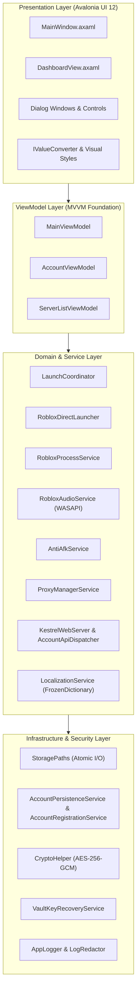
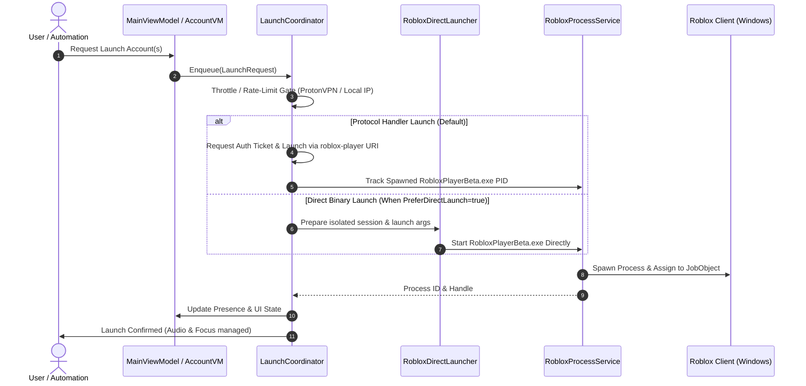

# Shiro Account Manager - Architecture Documentation

## 1. System Overview

**Shiro Account Manager** is a high-performance, enterprise-grade account manager and multi-instance orchestration platform built specifically for Roblox players, developers, and power users on Windows.

### Core Architecture Principles:
- **Framework & Runtime**: Pure modern .NET 10 (win-x64), C# 14, Avalonia UI 12.
- **Zero Native DLL Drop**: Direct usage of `System.Security.Cryptography` (AES-256-GCM, PBKDF2-SHA256, DPAPI).
- **Clean Architecture & Strict MVVM**: ViewModels never touch Windows API or UI Window instances directly. Verified automatically by `NetArchTest`.
- **High-Performance Memory & IO**: `ArrayPool<byte>`, `FrozenDictionary<string, string>` for O(1) localized string lookups, and Channels for non-blocking logging.
- **Micro-File Modularization**: 100% of `.cs` source files in `src/Shiro/` are strictly budgeted at `<= 485` lines (`<= 400` lines and `<= 200` chars/line for `.axaml`).

---

## 2. Architectural Layers



---

## 3. Account Launch & Orchestration Flow



---

## 4. Security Hardening Specifications

1. **Zero-Memory Key Clearing (`ZeroMemory`)**:
   - Master encryption key references in `StoragePaths`, `VaultKeyRecoveryService`, and `CryptoHelper` are explicitly wiped using `CryptographicOperations.ZeroMemory` upon shutdown, rotation, or credential erasure.
2. **Log Redaction (`LogRedactor`)**:
   - `AppLogger` intercepts and redacts `.ROBLOSECURITY` tokens, cookie values, passwords, query credentials, and bearer tokens before file and console write.
3. **Web Server & WebSocket Protection**:
   - Web Server requests enforce a maximum payload limit of 256 KB.
   - External connections are disabled by default.
   - Loopback verification (`IPAddress.IsLoopback`) and `Origin` header validation prevent Cross-Site WebSocket Hijacking (CSWSH).
   - Constant-time password verification (`FixedTimeEquals`) prevents timing side-channel attacks.
4. **Data Isolation**:
   - Path-traversal checks (`StoragePaths.IsWithinDirectory`) ensure browser profile sessions and temporary workspaces are securely isolated.

---

## 5. Architectural Quality Enforcement

Architecture rules are permanently verified on every build via `NetArchTest.eNhancedEdition` and source ratchets across `tests/Shiro.Tests/ArchitectureTests*.cs` (`ArchitectureTests.cs`, `ArchitectureTests.Budgets.cs`, `ArchitectureTests.Hygiene.cs`, `ArchitectureTests.Layering.cs`, `ArchitectureTests.Ratchets.cs`, `ArchitectureTests.SourceInvariants.cs`, `ArchitectureTests.StaticState.cs`):
- **MVVM & Layer Separation**: `ViewModels_ShouldNotDependOn_Views`, `Services_And_Classes_ShouldNotDependOn_Views`, `Services_ShouldNotDependOn_ViewModels` (allowlisting only 3 legacy files until decoupled), and `DomainFolder_ShouldNotDependOn_ViewModelsOrAvaloniaOrWin32Registry`.
- **Service Decoupling & DI (`AppServices`)**: Services in `Shiro.Services` resolve dependencies via `AppServices` (`IAccountRepository`, `IRobloxApiClient`, `ISettingsService`, `IAppLogger`, `IDialogService`, `IUserPrompt`, `IHostUiBridgeService`, `ISelectionStateService`, `IServerBrowserStateService`, `IToastNotifier`, `IRobloxServerQueryService`) rather than static `AccountManager.*`, `AppSettings.*`, or `Program.Logger` state (`AmbientStaticAccess_ShouldNotExceedPerFolderBaseline`).
- **Zero Sync-over-Async**: Automated checks verify zero `.GetAwaiter().GetResult()` / `httpClient.Send` blocking calls and enforce strict allowlists on `DispatcherFrame`/`PushFrame`, `.Wait(TimeSpan...)`, and `Thread.Sleep` across `src/Shiro/`.
- **Encoding & Localization Integrity**: Automated checks enforce zero `U+FFFD` replacement characters across `.cs`, `.axaml`, and `.json` files, ban Vietnamese diacritics outside `LocalizationService*`, and verify 100% of AXAML `{DynamicResource ([A-Za-z0-9_.]+)}` localization keys exist in `LocalizationService` (`DynamicResourcePattern()`).
- **Micro-File & Partial Class Budgets**: Automated tests enforce `<= 485` lines per `.cs` file in `src/Shiro/`, `<= 1,150` default lines across `partial class` definitions (with explicit baselines for `Account`, `MainViewModel`, `ServerListViewModel`), `<= 550` lines per test file, and `<= 400` lines (`<= 200` chars/line) per `.axaml`.
- **Naming Conventions**: Strict adherence to domain suffixes across the entire `Shiro.Services` namespace.

---

## 6. Dialog MVVM Architecture & Headless Decoupling

To ensure 100% testability and prevent UI thread deadlocks, all dialogs in Shiro Account Manager are architected with a decoupled MVVM foundation:
- **`DialogViewModelBase`**: Unified base class for dialog ViewModels, managing title, status text, reactive `StatusKind` (Idle, Busy, Success, Error), and standard confirmation/cancellation request events (`RequestClose`).
- **`IUserPrompt` Abstraction**: Replaces intrusive synchronous or asynchronous `MessageBox` calls with an injectable interface. In headless unit tests, mock implementations (`Substitute.For<IUserPrompt>()`) supply deterministic user responses (Accept, Decline, Retry) without showing UI dialogs.
- **`FastLoginCoordinator` & `FastLoginQueue`**: Separates WebView2 DOM injection, URL inspection, and batch queue state from the Avalonia code-behind.
- **Headless Test Coverage**: All dialog ViewModels (`CookieImportViewModel`, `BulkImportViewModel`, `ProxyManagerViewModel`, `MissingAssetsViewModel`, `AccountUtilsViewModel`, `SettingsViewModel`) are exercised by headless xUnit suites without Avalonia windowing dependencies.

---

## 7. Local HTTP & WebSocket Gateway Architecture (`KestrelWebServer`)

The local automation gateway provides REST endpoints and real-time WebSocket event streaming between Shiro and external tooling:
- **`KestrelWebServer`**: Hosts ASP.NET Core Kestrel endpoints (`LocalKestrelWebServer`) with WebSocket streaming on `/ws`, `/events`, and `/v2/events`, plus legacy and v2 REST routing.
- **`AccountApiDispatcher`**: Handles request routing, 256 KB payload size limits, account operations, and sanitized HTTP 500 error responses (`InternalErrorMessage`).
- **`ApiDocumentationService`**: Serves OpenAPI 3.0 JSON (`/swagger.json`, alias `/openapi.json`) and interactive API documentation (`/docs`, alias `/api/docs`).
- **`WebAuthPolicy`**:
  - Enforces loopback restriction unless external access is explicitly enabled with a configured password (`>= 12` chars via `MinExternalPasswordLength`).
  - Validates `Origin` headers to prevent Cross-Site WebSocket Hijacking (CSWSH).
  - Constant-time password comparison protects against side-channel analysis.

---

## 8. Source Directory Structure

```
src/Shiro/
├── AvaloniaUI/               # Presentation layer: Views, Controls, Converters, Styles, Assets
├── Domain/                   # Core domain models: Account, Avatar, GameClass, Server, NaturalStringComparer
├── Http/                     # HTTP client infrastructure (RestClient)
├── Resources/                # Icons, embedded localization JSON (Strings/*.json), datacenters & SVG flags
├── Services/                 # Business logic, orchestration, and infrastructure services
│   ├── Auth/                 # Authentication, session auditing, HBA crypto, WebAuthPolicy
│   ├── Launch/               # Roblox launch orchestration, batch operations, client patchers
│   ├── Network/              # External API dispatching, Kestrel gateway, RPC, presence monitoring
│   ├── Storage/              # Atomic file storage, account persistence, runtime store, serializers, vault encryption
│   ├── Ui/                   # Theme, dialogs, localization, toasts
│   └── Windows/              # Windows process monitoring (RobloxProcess*.cs, RobloxWatcher), window arrangement
├── ViewModels/               # Strict MVVM ViewModels, dialog ViewModels, command palette
├── AccountManager*.cs        # Application coordinator partial classes (Accounts, Launch, Lifecycle, ModernActions, Presence, RecentGamesAndSettings, WebServer)
├── GlobalUsings.cs           # Project-wide global usings
├── Program.cs                # Application entry point, single-instance mutex, crash handler
├── app1.manifest             # Windows application compatibility & DPI manifest
├── packages.lock.json        # Locked NuGet restore graph (win-x64)
└── Shiro.csproj              # .NET 10 project definition
```


---

## 9. Platform Scope & Accepted Risks

### 1. Windows x64 Exclusive Scope
Shiro targets `net10.0-windows` (`win-x64`) exclusively due to deep Win32 integrations:
- **DPAPI Secret Protection**: Windows Data Protection API for protecting sensitive credentials at rest.
- **WebView2 Embedded Chromium**: Windows-specific embedded browser control for Roblox web sessions and authentication flows.
- **Win32 Job Objects**: Process management and lifecycle grouping for spawned Roblox client instances.
- **WASAPI Audio Muting**: Low-level Windows Core Audio APIs for individual client audio management.
- **Window Arrangement & Tiling**: Native Win32 API calls (`SetWindowPos`, `GetWindowRect`, window enumeration) for desktop multi-window tiling.
- **System Tray**: Windows shell tray notification icons and background execution.

All native Win32 interop and process monitoring implementations are strictly isolated under `Services/Windows/` and `Services/Launch/`. Cross-platform execution (Linux/macOS) is explicitly out of scope.

### 2. Roblox Terms of Service (Accepted Product Risk)
Certain capabilities provided by Shiro—including multi-instance mutex management (`ROBLOX_singletonMutex`), `.ROBLOSECURITY` session handling, and anti-AFK automation—carry inherent Roblox Terms of Service (ToS) risk.
This is an **accepted product risk** explicitly disclosed to users in `README.md`. No architectural bypass or obfuscation layers are introduced; users assume responsibility for usage compliance.
