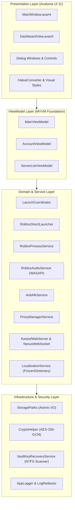
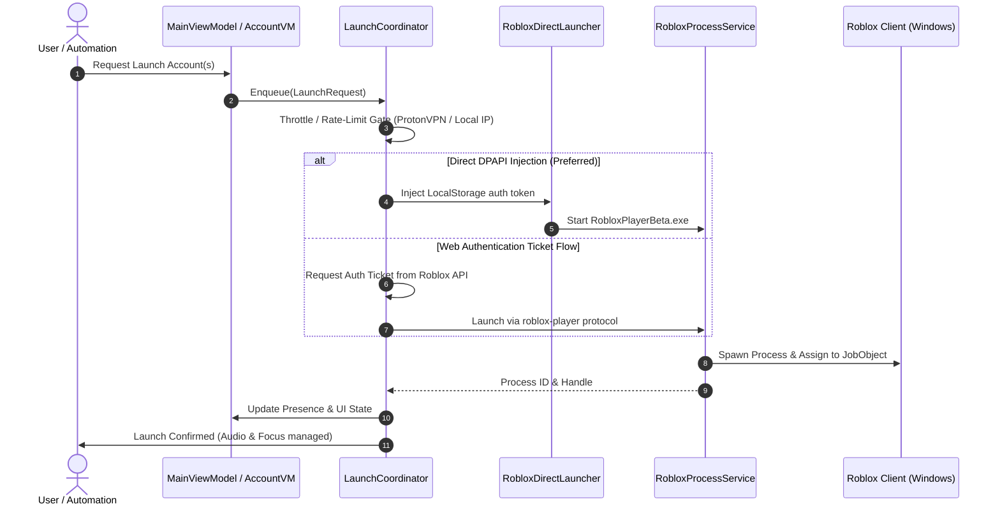

# Shiro Account Manager - Architecture Documentation

## 1. System Overview

**Shiro Account Manager** is a high-performance, enterprise-grade account manager and multi-instance orchestration platform built specifically for Roblox players, developers, and power users on Windows.

### Core Architecture Principles:
- **Framework & Runtime**: Pure modern .NET 10 (win-x64), C# 13, Avalonia UI 11.
- **Zero Native DLL Drop**: Direct usage of `System.Security.Cryptography` (AES-256-GCM, PBKDF2-SHA256, DPAPI).
- **Clean Architecture & Strict MVVM**: ViewModels never touch Windows API or UI Window instances directly. Verified automatically by `NetArchTest`.
- **High-Performance Memory & IO**: `ArrayPool<byte>`, `FrozenDictionary<string, string>` for O(1) localized string lookups, and Channels for non-blocking logging.
- **Micro-File Modularization**: 100% of source files strictly budgeted under 500 lines of code.

---

## 2. Architectural Layers

---

## 3. Account Launch & Orchestration Flow

---

## 4. Security Hardening Specifications

1. **Zero-Memory Key Clearing (`ZeroMemory`)**:
   - Master encryption key references in `StoragePaths.VaultKey` are explicitly wiped using `CryptographicOperations.ZeroMemory` upon shutdown or credential erasure.
2. **Log Redaction (`LogRedactor`)**:
   - `AppLogger` intercepts and redacts `.ROBLOSECURITY` tokens, cookie values, passwords, query credentials, and bearer tokens before file and console write.
3. **Web Server & WebSocket Protection**:
   - Web Server requests enforce a maximum payload limit of 256 KB.
   - External connections are disabled by default.
   - Loopback verification (`IPAddress.IsLoopback`) and `Origin` header validation prevent Cross-Site WebSocket Hijacking (CSWSH).
   - Constant-time password verification (`FixedTimeEquals`) prevents timing side-channel attacks.
4. **Data Isolation**:
   - Path-traversal checks (`StoragePaths.IsWithinDirectory`) ensure browser profile sessions and temporary workspaces are securely isolated.

---

## 5. Architectural Quality Enforcement

Architecture rules are permanently verified on every build via `NetArchTest.eNhancedEdition` in `tests/Shiro.Tests/ArchitectureTests.cs`:
- **MVVM Separation**: `Types.InAssembly(CoreAssembly).That().ResideInNamespace("Shiro.ViewModels").ShouldNot().HaveDependencyOnAny("Shiro.AvaloniaUI.Views")`.
- **Service Decoupling & DI (`AppServices`)**: Services in `Shiro.Services` resolve dependencies via `AppServices` (`IAccountRepository`, `IRobloxApiClient`, `IRobloxSessionService`, `IRobloxLauncherService`, `IDialogService`, `AppSettings`) rather than static `AccountManager.*` state.
- **Zero Sync-over-Async**: Automated checks verify zero `.GetAwaiter().GetResult()` blocking calls across `src/Shiro`.
- **Encoding & Localization Integrity**: Automated checks enforce zero `U+FFFD` replacement characters across `.cs`, `.axaml`, and `.json` files, and verify 100% of AXAML `{DynamicResource}` localization keys exist in `LocalizationService`.
- **Micro-File & Partial Class Budgets**: Automated tests enforce <= 500 lines per `.cs` file and strict line budgets across `partial class` definitions.
- **Naming Conventions**: Strict adherence to domain suffixes across the entire `Shiro.Services` namespace.
